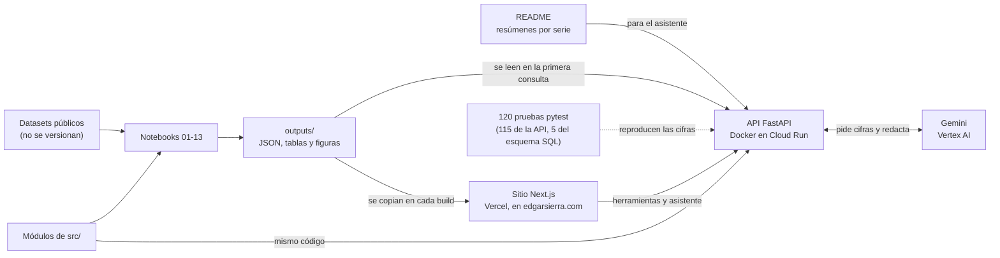

# Análisis de caña de azúcar: campo, fábrica y mercado

Solución de una prueba técnica de Científico de Datos para un ingenio azucarero de Guatemala. Recorre la cadena de
valor del ingenio con datos públicos: el **campo** (variedades de caña y renovación de lotes), la **fábrica** (una
caldera de cogeneración) y el **mercado** (producción mundial y precio del azúcar). Hice el análisis, lo llevé a una
API desplegada en Cloud Run, publiqué los resultados en mi sitio web para una audiencia de gerencia y agregué un
asistente que responde preguntas con las cifras de la API.

Autor: Edgar Sierra.

## En 1 minuto

- **Campo:** tres variedades dejan entre US$207 y US$272 más por acre al año que el testigo promedio, y conviene
  renovarlas cada 4 cortes. El precio del azúcar cambia cuánto se gana, no cuál variedad elegir (notebook 02).
- **Caldera:** el flujo de vapor se puede estimar con los sensores que ya existen, con 0.30 % de error (0.18 t/h),
  validado hacia adelante por día (notebook 08).
- **Mercado:** ningún modelo probado le gana al último cierre (~5 % de error a 1 mes). El valor está en el rango: la
  banda de 80 % cubrió 78 % de los meses a 1 mes y 84 % a 3 meses (notebook 12).
- **Puesta en marcha:** API con 14 consultas en Cloud Run, 120 pruebas aprobadas dentro de Docker con PostgreSQL 16,
  un sitio y una presentación para la gerencia, y un asistente con Gemini que responde con las cifras de la API.
- **Criterio:** la bitácora registra 84 decisiones técnicas, 24 hipótesis descartadas y 34 errores de fondo de la IA
  que detecté y corregí.

| Qué | Dónde |
|---|---|
| Sitio con los resultados, para la gerencia | [www.edgarsierra.com/analisis-cana-azucar](https://www.edgarsierra.com/analisis-cana-azucar) |
| Presentación ejecutiva (Serie V) | [/analisis-cana-azucar/presentacion](https://www.edgarsierra.com/analisis-cana-azucar/presentacion) |
| Herramientas que consultan la API en vivo | [/analisis-cana-azucar/herramientas](https://www.edgarsierra.com/analisis-cana-azucar/herramientas) |
| Asistente en lenguaje natural | [/analisis-cana-azucar/asistente](https://www.edgarsierra.com/analisis-cana-azucar/asistente) |
| API, documentación interactiva (OpenAPI) | [analisis-cana-api…run.app/docs](https://analisis-cana-api-36437889250.us-central1.run.app/docs) |
| Código | [github.com/edgarsierra-gt/analisis-cana-azucar](https://github.com/edgarsierra-gt/analisis-cana-azucar) |

**Tecnologías:** Python 3.12 (pandas, scikit-learn, statsmodels), SQL y PostgreSQL 16, FastAPI y pydantic, pytest,
Docker Compose, Google Cloud Run, Vertex AI (Gemini), Next.js en Vercel y Observable Plot.

**Cómo revisarlo en 5 minutos:**
1. La [presentación](https://www.edgarsierra.com/analisis-cana-azucar/presentacion): 18 diapositivas.
2. Una consulta en vivo en las [herramientas](https://www.edgarsierra.com/analisis-cana-azucar/herramientas).
3. La [documentación de la API](https://analisis-cana-api-36437889250.us-central1.run.app/docs).
4. El resumen al inicio de [`bitacora.md`](bitacora.md).

## Qué entrego

| Serie | Qué responde | Dónde está |
|---|---|---|
| I · Campo | qué 3 variedades ampliar y cada cuántos cortes renovarlas, cuánto azúcar esperar por finca, qué perfil tiene cada variedad y qué datos capturar | notebooks 01-05, `src/campo_*.py`, `sql/` |
| II · Fábrica | confiabilidad de los 30 sensores, zonas de carga, sensor virtual del vapor, alertas y eficiencia | notebooks 06-09, `src/fabrica_*.py` |
| III · Mercado | pares de Guatemala entre los países productores, comportamiento del precio No. 11, pronóstico a 1 y 3 meses y respuesta de la oferta | notebooks 10-13, `src/mercado_*.py` |
| IV · Producción | API REST con 14 consultas, Docker Compose y 120 pruebas automatizadas, desplegada en Cloud Run | `api/`, `tests/`, `Dockerfile`, `docker-compose.yml` |
| V · Presentación | 18 diapositivas para 15-20 minutos, con notas del orador y guion de demostración | `web/src/app/presentacion/` y el sitio |
| Puntos extra | herramientas que consultan la API y un asistente con Gemini en Vertex AI | `web/`, `api/asistente.py` |

El notebook 01 es la auditoría de los datos y cierra con las decisiones que pasan al modelado. Del 02 al 13, cada
notebook cierra con una evaluación gerencial: qué significa para el ingenio, qué decisión recomiendo, su impacto
estimado, sus riesgos y con qué certeza lo afirmo.

**Cobertura de la prueba**

| Lo que pedía la prueba | Estado | Dónde |
|---|---|---|
| Series I a III | Hechas. En la Serie I, pregunta 2, el escenario 3 (variedad nueva) queda diseñado, no desarrollado | notebooks 01-13, [Pendientes](#pendientes-y-cómo-los-abordaría) |
| Serie IV: API, Docker Compose y pruebas | Hecha y desplegada en Cloud Run | `api/`, `tests/` |
| Serie V: presentación de 15-20 minutos | Hecha: 18 diapositivas con notas del orador | `/presentacion` |
| Extra: aplicación de predicción | Hecha | `/herramientas` |
| Extra: servidor MCP, bot de Telegram con n8n y modelo local | Resuelto a mi manera, con un asistente web en Vertex AI; explico por qué en [Puntos extra](#puntos-extra) | `/asistente` |
| Extra: MLflow | No lo instalé; explico cómo elijo, versiono y monitoreo sin él, y cuándo lo agregaría | [MLflow](#mlflow-cómo-elijo-versiono-y-monitoreo-los-modelos) |

## Cómo decidí

Cuatro reglas se repiten en las tres series (detalle en el resumen de `bitacora.md`):

1. **Auditar los datos antes de modelar.** Cada serie tenía una trampa en el archivo: coma decimal y unidades en
   libras, no toneladas (campo); un archivo con 30 valores inventados (caldera); un precio que pega contratos
   distintos (mercado).
2. **Probar contra el azar antes de hablar de grupos o ciclos.** En ninguna serie hay grupos naturales, y los ciclos
   del precio no se distinguen de un paseo aleatorio. Uso los grupos como tipologías útiles, no como hechos.
3. **Validar como se usaría.** Siempre hacia adelante en el tiempo y sin fuga de información del futuro: por zafra,
   por día, con origen rodante. En la caldera (notebook 08), la validación al azar prometía entre 17 % y 51 % menos
   error del real.
4. **Simple antes que complejo.** En las tres series el modelo lineal o el ingenuo empató o le ganó a los árboles y a
   ARIMA. Si un modelo complejo no gana con significancia, se queda el que se explica.

Dos principios las acompañan:
- **Decir la certeza.** Cada recomendación lleva su banda, su intervalo o su nivel de certeza, y por qué.
- **Trasladar el método, no las cifras.** Los datos son públicos y de otros lugares (ensayos de Louisiana, una
  caldera a carbón, el mercado mundial). Las cifras para el ingenio saldrán de sus propios datos.

### Una decisión difícil: no aprender lo que los datos no alcanzan a enseñar

Para pronosticar el azúcar por finca, una regresión con todas las variables perdió contra una regla sin aprendizaje
(error de 1,566 contra 1,497 lb/acre). Con unas 10 zafras, la constante aprendía la suerte de los años de
entrenamiento: 2011 y 2012 fueron +11 % y +15 %. Separé el problema en dos piezas. El nivel de la finca sale de su
historia, sin pesos aprendidos, y solo aprendo la ventaja de la variedad, que tiene miles de comparaciones limpias
dentro de cada lote. El Ridge final empata con Random Forest y XGBoost en error total, les gana al estimar la ventaja
de cada variedad y se explica con 3 coeficientes. Su banda cubrió 74 % en zafras futuras, y reporto ese 74 %, no el
80 % nominal (bitácora H4 y D24-D27).

### Uso de IA

Usé Claude (chat y Claude Code) como asistente: para escribir y ejecutar código, hacer cálculos, redactar borradores
y revisar cifras. Las preguntas, los métodos y las decisiones son míos, y no acepté un resultado sin verificarlo con
los datos. La bitácora registra los 34 errores de fondo de la IA que corregí y las 3 sugerencias suyas que descarté;
de cada uno anoto cómo lo verifiqué. Al cerrar las Series I, II y III pedí a un agente de IA separado, que no
participó en el análisis, comparar cada cifra contra las salidas de los notebooks, y corregí todo lo que encontró.

## Cómo está armada la solución



1. **Análisis.** Cada pregunta tiene su notebook, y la lógica reutilizable vive en `src/`, la misma que usan la API y
   las pruebas. Los notebooks escriben sus resultados en `outputs/`.
2. **Una sola fuente de verdad.** La API y el sitio leen esos archivos y no reentrenan. Las pocas cifras del sitio que
   no están en un JSON las escribí a mano desde su notebook, la bitácora o el código, casi todas con su fuente en un
   comentario. Si se vuelve a correr un notebook con datos nuevos, la API y el sitio se actualizan en el siguiente
   despliegue.
3. **Producción.** La API se construye con el mismo `Dockerfile` en local y en Cloud Run. Las pruebas comprueban que
   responde con las cifras de los notebooks.
4. **Presentación.** El sitio cuenta cada serie para una gerencia no técnica, con gráficos, tablas, la evaluación
   gerencial y la fuente de cada cifra. La presentación ejecutiva y la demostración viven en el mismo sitio.
5. **Asistente.** Responde preguntas en español sobre las tres series. Está diseñado para no calcular: pide las cifras
   a la API y redacta con lo que recibe.

## Resultados por serie

Los tres resúmenes siguientes los consulta también el asistente (`api/asistente.py` busca estos títulos). El detalle,
con su evidencia, está en cada notebook y en el sitio.

## Serie I · Resumen para la Gerencia Agrícola

Método común: cada variedad se compara contra 4 testigos fijos en el mismo ensayo y corte, se mide su longevidad y
todo se lleva a dinero con su certeza (bootstrap de ensayos). Datos de Louisiana: se traslada el método, no las
variedades.

1. **Qué ampliar y cuándo renovar (notebook 02).** HOCP14-885 (+US$272/acre/año frente al testigo promedio, IC90
   226-319), HOL15-508 (+250, IC90 183-325) y L15-306 (+207, IC90 166-248). Renovar cada 4 cortes. El precio cambia
   cuánto se gana, no cuál variedad elegir; el equilibrio de las tres está en US$0.11-0.12/lb.
2. **Cuánto azúcar esperar (notebook 03).** Ridge en dos piezas (nivel de la finca + ventaja de la variedad): error
   típico de 22 % por parcela (una variedad en una finca y zafra) contra 24 % del promedio histórico, y ordena variedades dentro del lote (ρ 0.44; 0.51 en
   socas). El 77 % del error es clima y manejo del lote-año: presupuestar con banda (−29 % / +32 %, cubrió 74 %).
3. **Qué rol darle a cada variedad (notebook 04).** No hay grupos naturales, pero 5 perfiles moderadamente
   reproducibles al remuestrear (ARI 0.62) explican el 74 % de la variación de la ganancia de la pregunta 1. Hay un
   compromiso entre tonelaje y calidad, y la calidad viene con longevidad. Uno de los testigos núcleo es inestable.
4. **Cómo decidir con datos propios (notebook 05).** Auditar renovaciones con los registros que ya existen (número de
   corte obligatorio), calcular el ciclo por zona de costo, zonificar lotes con los estratos de CENGICAÑA y hacer
   ensayos en 20 fincas por cohorte (5 por estrato) con testigos estables. Con el mismo número de parcelas extra,
   sumar fincas sube la potencia 2.6 veces más que sumar repeticiones (+5.9 contra +2.3 puntos); ventajas de 5 % no
   se separan del ruido.

Explicación visual e interactiva: `docs/serie1_explicacion.html`.

## Serie II · Resumen para la Gerencia Industrial

Caldera de lecho fluidizado circulante a carbón (≈60 t/h, 9.8 MPa, 540 °C), 30 sensores cada 5 s durante 5 días.
En el ingenio las calderas son de bagazo: se traslada el método, no los valores.

1. **Datos (notebook 06).**
   - `data_AutoReg.csv` inventa 30 valores; uso `data.csv`.
   - El diccionario no trae unidades y describe mal al menos un sensor.
   - Cinco sensores, incluido el flujo de vapor, se actualizan cada 10 s.
   - Un diferencial de presión copia la presión del hogar (toma tapada o tag mal asignado) y una vibración es ruido:
     ambos quedan fuera de los modelos.
   - Los ~70 picos diarios de la corriente del tiro inducido son respuesta del control, no errores.
2. **Regímenes (notebook 07).**
   - No hay estados separados: la carga manda.
   - Hay tres zonas de carga y un eje de operación independiente de ella: los minutos con más O₂ y más atemperación
     tienen el vapor ~7 °C más frío (descriptivo).
   - El efecto que se mide es la atemperación: sus cambios enfrían el vapor ~5 min después.
   - El único régimen discreto es el ciclo del lecho: se llena ~5.4 h y se descarga ~1.5 h, sin afectar la
     producción.
3. **Sensor virtual (notebook 08).**
   - La caída de presión domo → colector ya es un medidor de flujo: Q ∝ √(ΔP·ρ), con 0.5 % de error.
   - El Ridge completo llega a 0.30 % (0.18 t/h, R² 0.99), validado hacia adelante por día.
   - El gradient boosting es peor. Sin presiones de vapor, el respaldo da 1.1 %.
   - La caldera responde en 1-2 min.
4. **Anomalías (notebook 09, parte A).** Tres capas: reglas físicas, verificación de sensores por redundancia y un
   monitor PCA (T² y SPE) con ventana móvil.
   - El criterio para separar sensor de equipo: un sensor se separa de sus pares; un equipo mueve variables acopladas
     y los pares coinciden.
   - Con 5 fallas inyectadas, 5 de 5 bien clasificadas.
   - ~9 alarmas por día entre las tres capas, todas con diagnóstico. Los umbrales de las reglas se calibraron con
     estos mismos datos, así que esa cifra sale en parte por construcción.
5. **Eficiencia (notebook 09, parte B).**
   - **Limpieza de superficies:** los gases hacen un serrucho de ~8 h, compatible con ensuciamiento y soplado (o con
     el ciclo del lecho; sin registro de soplados no se distingue). Su base sube ~2 °C/día. Si es ensuciamiento,
     recuperar la deriva vale 0.1-0.3 puntos de eficiencia, unos US$10-23 mil al año con supuestos declarados.
   - **Exceso de aire:** ya está bajo; ahorra menos de 0.1 punto.
   - **Temperatura del vapor:** su valor está en la turbina.
   - Para estimar en absoluto faltan combustible, chimenea y CO.

Explicación visual e interactiva: `docs/serie2_explicacion.html`.

## Serie III · Resumen para la Gerencia General y Comercial

1. **Países (notebook 10).**
   - **Datos poco confiables en FAOSTAT:**
     - Liberia repite el mismo rendimiento 33 años, y Guinea y Papúa Nueva Guinea no tienen datos oficiales.
     - Los departamentos franceses dejan de reportar en 2006.
     - En 2023, menos de la mitad de los datos del panel son oficiales.
     - Guatemala: la producción de 2014-2016 está inflada y el área de 2019-2023 es imputada (el USDA reporta 12-15 %
       más área en 2021-2022).
   - **No hay grupos naturales bien separados.** Uso una tipología de tres: expansión, madurez y datos dudosos.
   - **Guatemala** es uno de 4 países de 71 en el cuartil superior de crecimiento del área **y**, a la vez, de nivel
     de rendimiento (2014-2023). Sus pares por trayectoria son El Salvador, Eswatini, Brasil, Nicaragua y Egipto, no
     Colombia ni México.
2. **Precio (notebook 11).**
   - **La serie pega contratos.** Hay 97 saltos por cambio de contrato que no son mercado; los corrijo.
   - **Dos regímenes de volatilidad:** calma (3.5 % semanal) y turbulencia (5.9 %).
   - **Colas pesadas:** unas 36 veces más días de más de 4 desviaciones que una distribución normal. Los ciclos de
     nivel no se distinguen del azar.
   - **La serie es real:** los extremos coinciden al centavo y al día con fuentes públicas, y los promedios anuales
     coinciden con el FMI (−1 % a +3 %) y con el Banco Mundial (0 % a +4 %).
3. **Pronóstico (notebook 12).**
   - Ningún modelo probado le gana al **último cierre** a 1 y 3 meses: ~5 % y ~12 % de error.
   - La utilidad está en la **banda según volatilidad**, que queda calibrada. Cada ¢/lb equivale a US$22/t.
4. **Oferta (notebook 13).**
   - **Asociación robusta pero pequeña** del área con el precio de 2-3 años antes: elasticidad acumulada de ~0.08.
     Sobrevive a controlar la inercia (ARDL), a quitar cualquier año y a usar solo datos oficiales.
   - **La evidencia causal es débil:**
     - la permutación da p = 0.05-0.08 a una cola;
     - el placebo del año siguiente falla en algunas muestras (la oferta también mueve el precio);
     - la versión ponderada por tamaño (~0.17, p = 0.01) es exploratoria.

Explicación visual e interactiva: `docs/serie3_explicacion.html`.

## Serie IV · API en producción

Los modelos de la Serie I, y los de la caldera y el mercado de las Series II y III, se exponen como una API REST
(FastAPI), con validación de entradas y documentación OpenAPI. Es pública, como demostración. No necesita los
datasets: lee los JSON de `outputs/models/` y calcula igual que los notebooks. Corre en Cloud Run (us-central1), con
0 instancias mínimas y 2 máximas. Detalle de cada consulta, ejemplos y para qué sirve: [`docs/api.md`](docs/api.md).

| Qué | Cómo (desde la raíz del repositorio) |
|---|---|
| Usarla en línea (Cloud Run) | [https://analisis-cana-api-36437889250.us-central1.run.app/docs](https://analisis-cana-api-36437889250.us-central1.run.app/docs) |
| Levantar la API (con Docker Desktop abierto) | `docker compose up --build` → documentación interactiva en `http://localhost:8000/docs` |
| Correr todas las pruebas, incluida PostgreSQL 16 (con Docker Desktop abierto) | `docker compose --profile pruebas run --rm pruebas` |
| Sin Docker | `pip install -r requirements.txt`, luego `uvicorn api.main:app --reload` y `pytest` |
| Desplegar en Cloud Run | `gcloud run deploy analisis-cana-api --source . --region us-central1 --allow-unauthenticated --min-instances 0 --max-instances 2 --memory 1Gi` (Cloud Build construye la imagen con el mismo `Dockerfile`; `.gcloudignore` deja fuera datos, notebooks y el sitio) |

| Consulta | Serie y pregunta |
|---|---|
| `GET /campo/variedades`, `POST /campo/ciclo` | I · 1 · ranking, ciclo de renovación y precio de equilibrio |
| `POST /campo/pronostico` | I · 2 · azúcar por acre esperado, con banda |
| `POST /campo/segmento` | I · 3 · grupo de una variedad |
| `POST /campo/auditoria`, `POST /campo/auditoria/csv` | I · 4 · auditoría de renovaciones por lote |
| `GET /caldera/sensores` | II · 1 · diccionario corregido de los 30 sensores |
| `POST /caldera/modo` | II · 2 · zona de carga de una ventana de 5 min |
| `POST /caldera/vapor-virtual` | II · 3 · sensor virtual del flujo de vapor |
| `POST /caldera/verificar` | II · 4 · verificación de sensores: ¿falla el sensor o es el proceso? |
| `GET /mercado/pronostico` | III · 3 · precio del azúcar a 1 y 3 meses con bandas |
| `POST /asistente`, `GET /asistente/estado` | preguntas en español sobre las tres series (detalle en [Puntos extra](#lenguaje-natural-asistente-con-gemini-en-vertex-ai)) |
| `GET /salud` | estado del servicio, versión y cuántas variedades y grupos cargó |

**Seguridad y límite de uso.**
- La API es pública y sin llave, así que cada IP tiene 40 consultas por minuto y 300 por día, con un tope de 5,000
  diarias. El asistente tiene una cuota aparte: 30 preguntas por IP al día, 5 por minuto y 300 en total. Al pasarse
  responde 429 con un mensaje en español. Los conteos viven en la memoria de cada instancia: con 2 instancias como
  máximo, los topes reales son a lo sumo el doble.
- Solo la consultan desde el navegador `edgarsierra.com`, los dominios de este proyecto en Vercel y `localhost`
  (CORS).
- Cada campo tiene un rango físico o económico, y los errores de validación (422) nombran en español el campo que hay
  que corregir.
- No hay secretos en el repositorio: Cloud Run entra a Vertex AI con su cuenta de servicio. Los datasets y el
  enunciado de la prueba no se versionan.
- Ni el repositorio, ni el sitio, ni la API nombran al ingenio.

**Costos.** Cloud Run escala a cero cuando nadie la usa; el sitio es estático en el plan gratuito de Vercel; Vertex AI
cobra por pregunta y la cuota lo acota. Todo lo que pide la prueba (notebooks, API con Docker y pruebas) corre gratis
en local.

**Pruebas.** Llaman a la API y reproducen las cifras de los notebooks:
- `tests/test_api.py` (Serie I): margen de referencia US$526.3/acre/año, las 23 variedades del notebook 02, las 509
  predicciones de 2022 (≤ 1 lb/acre), el 100 % de las asignaciones de grupos y 1,143/1,143 ciclos de la auditoría en
  el portafolio simulado del notebook 05.
- `tests/test_api_caldera_mercado.py` (Series II y III): el 100 % de las 1,441 ventanas de modo, el Ridge final del
  sensor virtual en 171 minutos, los 12 chequeos de verificación igual que `src/fabrica_anomalias`, el diagnóstico
  sensor contra proceso con fallas inyectadas y las bandas del pronóstico del notebook 12.
- `tests/test_limites.py`: cuotas por IP y global, reinicio a medianoche, 429 y errores en español.
- `tests/test_asistente.py`: con un modelo falso (sin llamar a Vertex AI), las herramientas de ranking, ciclo,
  pronóstico de azúcar y precio dan lo mismo que su consulta en la API, y las 9 responden con su fuente; el bucle se
  detiene en 6 pasos; modelo de respaldo, cuota, 422, 502 y 503.
- `tests/test_esquema_postgres.py`: el esquema SQL contra PostgreSQL 16 (se omite sin `CAMPO_PG_DSN`).

Última corrida dentro de Docker, con PostgreSQL 16: 120 pruebas aprobadas (`outputs/tests/pytest_docker.txt`). Las
corro antes de cada despliegue; todavía no hay integración continua (ver [Pendientes](#pendientes-y-cómo-los-abordaría)).

## Serie V · Presentación ejecutiva

Está en el sitio: [/analisis-cana-azucar/presentacion](https://www.edgarsierra.com/analisis-cana-azucar/presentacion).

- **Para quién:** Gerencia General, Agrícola e Industrial, en lenguaje de negocio.
- **Qué tiene:** 18 diapositivas en formato 16:9. Por cada serie, las preguntas clave y su evaluación gerencial
  (recomendación, impacto, riesgos y certeza). Cierra con la API, la demostración, las decisiones y los próximos
  pasos.
- **Para 15-20 minutos:** las notas del orador (tecla N) traen lo que digo y respuestas a preguntas probables. Se
  avanza con las flechas y se imprime a PDF desde el navegador.
- **Para profundizar:** cada diapositiva de contenido (13 de 18; no la portada, los separadores ni el cierre) enlaza a
  la sección del sitio con la metodología, la evidencia, los supuestos y los límites de ese análisis.
- **Demostración:** la diapositiva 16 trae el guion de cuatro consultas en vivo en `/herramientas`.

La mayoría de sus cifras se calculan de los mismos archivos de `outputs/` que usa el resto del sitio. Las pocas
escritas a mano (como las 120 pruebas o las 84 decisiones) salen de las pruebas y la bitácora.

## Puntos extra

### Aplicación de predicción: `/herramientas`

[Calculadoras que consultan la API en vivo](https://www.edgarsierra.com/analisis-cana-azucar/herramientas):

- **Campo, pregunta 1:** ciclo de renovación y margen de una variedad con el precio del azúcar y los costos que elija
  el usuario.
- **Campo, pregunta 2:** azúcar esperado de una variedad en una finca y número de corte, con su banda.
- **Campo, pregunta 4:** auditoría de renovaciones subiendo el CSV de cosechas (hay un archivo de ejemplo).
- **Caldera, preguntas 3 y 4:** escenarios de operación para el sensor virtual y la verificación de sensores.
- **Mercado, pregunta 3:** rango del precio a 1 y 3 meses y del ingreso de las toneladas sin fijar.

### Lenguaje natural: asistente con Gemini en Vertex AI

La prueba proponía un servidor MCP, un bot de Telegram con n8n y un modelo local (Ollama), y el correo de la prueba
dejó libre la elección de herramientas. Resolví la misma necesidad con
[el asistente del sitio](https://www.edgarsierra.com/analisis-cana-azucar/asistente): preguntar en lenguaje natural y
recibir respuestas calculadas con los datos. Usé una arquitectura que conozco y que llevaría a producción en una
empresa.

**Cómo funciona.** Gemini (`gemini-3.5-flash`, con `gemini-3.5-flash-lite` de respaldo) recibe la pregunta, los
últimos mensajes y 9 herramientas. Seis usan las mismas funciones que las consultas de la API: ranking de variedades,
ciclo de renovación, pronóstico de azúcar, catálogo, sensores de la caldera y pronóstico del precio. Las otras tres
leen directo los resultados de los notebooks 04 y 08 (grupos de variedades y métricas del sensor virtual) y los
resúmenes por serie de este README. El modelo pide la herramienta que necesita, la API la ejecuta y él redacta con el
resultado, citando la fuente. Cuando una cifra no aplica a la pregunta, la herramienta no la entrega: por ejemplo, la
certeza del ranking se calculó con el precio base y no se entrega si se pregunta por otro precio. La página del
asistente explica el flujo con un diagrama.

**Por qué así.**

| Criterio | Bot de Telegram con n8n y modelo local | Asistente web con Vertex AI |
|---|---|---|
| Acceso | Instalar Telegram, estar autorizado y tener encendido el equipo que corre el modelo | Abrir una página, sin instalar nada |
| Seguridad | Un token de bot, una lista de usuarios y un flujo de n8n que custodiar | Sin llaves: Cloud Run entra a Vertex AI con su cuenta de servicio (IAM). Cuota por IP, y las instrucciones tratan lo que devuelven las herramientas como datos, no como órdenes |
| Dónde se procesan las preguntas | El modelo corre en un equipo propio, pero los mensajes pasan por Telegram | En Vertex AI (Google Cloud), en el mismo proyecto que la API. El servidor no guarda las conversaciones |
| Operación | Tres servicios más que mantener (n8n, el bot y el modelo) | Un endpoint más dentro de la API que ya existe, con sus pruebas |
| Escala | Limitada al equipo que corre el modelo | Serverless; si el modelo principal se satura, entra el de respaldo |
| Costo | Gratis, pero con hardware encendido | Pago por uso, acotado por la cuota diaria |
| Lo que se pierde | Nada sale de los equipos propios, salvo los mensajes | Depende de Google Cloud y de internet, y cada pregunta tiene costo |

**Cómo lo verifiqué.** Las pruebas usan un modelo falso para comprobar que las herramientas de ranking, ciclo,
pronóstico de azúcar y precio dan lo mismo que su consulta en la API, que las 9 responden con su fuente, que el bucle
se detiene en 6 pasos y que la cuota funciona. Con el modelo real probé seis preguntas: cuatro de las series, una
fuera de tema y un intento de que revelara sus instrucciones y el nombre del ingenio. Respondió con las cifras de la
API en las cuatro primeras y declinó las dos últimas. No hay una evaluación automática con el modelo real.

**Cómo lo extendería.**
- **Alertas al jefe de calderas:** hoy la verificación se consulta con `POST /caldera/verificar`. En planta, un
  proceso programado (Cloud Scheduler) la llamaría cada minuto con los datos del historiador de la planta (el sistema
  que guarda las lecturas de los sensores) y mandaría la alerta por el canal que use el ingenio.
- **Servidor MCP:** las 9 herramientas ya tienen nombre, descripción y esquema de entrada. Exponerlas como servidor
  MCP es envolverlas, sin tocar la lógica.
- **Telegram, si el ingenio lo prefiere:** el mismo `POST /asistente` detrás de un bot, con la lista de usuarios
  autorizados y el token en Secret Manager.

### MLflow: cómo elijo, versiono y monitoreo los modelos

No instalé MLflow. Con un entrenamiento por notebook y modelos que caben en un JSON, lo resolví con git y pruebas:

- **Elegir:** validación hacia adelante en el tiempo y bootstrap pareado contra el modelo simple. Si el complejo no
  gana con significancia, se queda el simple.
- **Versionar:** cada modelo es un JSON en `outputs/models/` y el commit es su versión. Corro las pruebas antes de
  desplegar, y cada despliegue de Cloud Run queda como una revisión a la que se puede volver.
- **Monitorear:** cada zafra, comparar el azúcar real contra la banda del pronóstico (cubrió 74 % en la validación);
  en la caldera, el sensor virtual contra el medidor; en el mercado, cuántos meses caen fuera de la banda. Si se
  salen, volver a correr el notebook con datos nuevos y publicar el JSON.
- **Cuándo agregaría MLflow:** cuando haya reentrenamientos periódicos y varios experimentos por modelo. Registraría
  parámetros, métricas de la validación hacia adelante y el JSON como artefacto, y usaría su registro de modelos para
  promover versiones.

## Por qué elegí estas herramientas

| Necesidad | Elegí | Por qué |
|---|---|---|
| Análisis y modelos | Python 3.12, pandas, scikit-learn, statsmodels | El enunciado indica que el área de datos del ingenio usa Python y PostgreSQL. Prioricé modelos que se explican (ver [Cómo decidí](#cómo-decidí)). |
| Modelos para producción | JSON legibles en `outputs/models/`, sin pickles | Un pickle depende de la versión exacta de la librería. Un JSON se audita en cualquier editor, y la API no necesita los datasets ni reentrenar. Los notebooks 02, 03 y 04 comprueban que su JSON reproduce sus propias cifras. |
| API | FastAPI y pydantic | La validación de entradas y la documentación OpenAPI salen del mismo código. |
| Empaquetado | Docker Compose | Un comando levanta la API y otro corre las 120 pruebas, con un PostgreSQL 16 temporal. |
| Base de datos | PostgreSQL 16 (`sql/esquema_campo.sql`) | El modelo de datos de campo (pregunta 4) se prueba contra PostgreSQL real: sus reglas rechazan cuatro errores de captura, y la auditoría de renovaciones con los datos leídos de la base da los mismos estados que con pandas. |
| Despliegue de la API | Cloud Run (Google Cloud) | Es serverless: escala a cero cuando nadie la usa y tiene un tope de 2 instancias para acotar el costo. Usa el mismo `Dockerfile` que en local, con HTTPS y sin servidores que mantener. |
| Presentar los resultados | Sitio en Next.js, desplegado en Vercel y publicado en mi dominio | Una gerencia no abre notebooks. El sitio se abre en cualquier dispositivo, cada página es estática (rápida y sin costo de servidor) y se despliega sola con cada push a `main`. Lo publiqué en `edgarsierra.com` con un rewrite para mostrar el ciclo completo en un entorno real, no solo en mi computadora. |
| Gráficos y diseño | Observable Plot y un sistema de diseño propio (`web/DESIGN.md`) | Gráficos sobrios, numerados y con su fuente, pensados para leer una cifra en 30 segundos y verificarla en 3 minutos. |
| Presentación ejecutiva | Diapositivas dentro del mismo sitio | Leen los mismos archivos que el resto del sitio, tienen notas del orador y la demostración de la API queda a un clic. |
| Lenguaje natural | Gemini en Vertex AI con llamadas a funciones | Ver [Puntos extra](#lenguaje-natural-asistente-con-gemini-en-vertex-ai). |

## Calidad y verificación

Una corrida limpia, en un entorno nuevo (versiones en `bitacora.md`, "Corrida limpia en Windows"), reproduce las
cifras de control:

| Cifra de control | Dónde se comprueba | Resultado |
|---|---|---|
| Margen de referencia con los supuestos de la prueba | notebook 02 | US$526.3/acre/año |
| El JSON reproduce el ciclo y el margen de cada variedad | notebook 02 | diferencia 0 |
| Predicciones de 2022 del notebook 03, reproducidas con el JSON del modelo | `docs/serie1_explicacion.html` y pruebas de la API | 509, diferencia ≤ 0.7 lb/acre |
| Asignaciones de grupo reproducidas con el JSON | notebook 04 | 100 % |
| Ciclos bien clasificados por la auditoría, en un portafolio simulado de 480 lotes | notebook 05 | 1,143 de 1,143 |

- Las Series II y III dan las mismas salidas en una corrida nueva, salvo ruido numérico (documentado en la bitácora).
- Las 120 pruebas (115 de la API y 5 del esquema SQL) corren dentro de Docker con PostgreSQL 16.

## Cómo ejecutar

### Notebooks

Probado con Python 3.12 (corrida limpia en Windows e imagen de Docker).

1. `pip install -r requirements.txt`
2. Colocar los datasets (no se versionan):
   - Serie I: el CSV de Louisiana en `data/raw/All_Genotypes_2010_onwards.csv` (fuente: data.gov / Ag Data Commons,
     "Louisiana Sugarcane yield data (2010-2021)").
   - Serie II: `data.csv`, `data_AutoReg.csv` y `columns.csv` en `data/raw/serie2/` (dataset *Time-Series of
     Industrial Boiler Operations*).
   - Serie III, en `data/raw/serie3/`: `Production_Crops_Livestock_E_All_Data.csv` y
     `Production_Crops_Livestock_E_All_Data_NOFLAG.csv` (FAOSTAT, *Production: Crops and livestock products*, todos los
     datos), `all_agricultural_products_data.csv` e `individual_data/` con `Sugar_data.csv`, `Coffee_data.csv`,
     `Cocoa_data.csv` y `Cotton_data.csv` (*Agricultural Commodities Futures*).
3. Desde `notebooks/`, en orden, con `jupyter nbconvert --to notebook --execute --inplace <notebook>.ipynb` (y
   después `jupyter nbconvert --to html <notebook>.ipynb` para regenerar su versión HTML):
   - Serie I: `01_campo_eda`, `02_campo_recomendacion`, `03_campo_modelo`, `04_campo_segmentos` y
     `05_campo_datos_propios` (del 03 en adelante leen salidas del 02).
   - Serie II: `06_fabrica_datos`, `07_fabrica_regimenes`, `08_fabrica_sensor_virtual` y
     `09_fabrica_anomalias_eficiencia` (el 07 y el 09 leen el resumen del 06; el 08 no depende de otro notebook).
   - Serie III: `10_mercado_paises`, `11_mercado_precio`, `12_mercado_pronostico` y `13_mercado_oferta`, en cualquier
     orden (cada uno lee los datos crudos; ninguno depende de otro).
4. Documentos explicativos interactivos (desde la raíz): `python docs/build_serie1_explicacion.py`,
   `python docs/build_serie2_explicacion.py` y `python docs/build_serie3_explicacion.py` regeneran
   `docs/serie1_explicacion.html`, `docs/serie2_explicacion.html` y `docs/serie3_explicacion.html` con las cifras de
   los notebooks. Se abren en cualquier navegador; no necesitan servidor.

| Notebook | Pregunta | Tiempo aproximado |
|---|---|---|
| `01_campo_eda` | auditoría y EDA del dataset de campo | ~15 s |
| `02_campo_recomendacion` | I · 1: variedades, ciclo de renovación y certeza | ~3 min (bootstrap) |
| `03_campo_modelo` | I · 2: modelo supervisado, escenarios 1 y 2 | ~2 min |
| `04_campo_segmentos` | I · 3: segmentación de variedades | ~1.5 min |
| `05_campo_datos_propios` | I · 4: datos a capturar, auditoría de renovaciones, zonificación y tamaño de ensayos | ~30 s |
| `06_fabrica_datos` | II · 1: confiabilidad de archivos y sensores | ~25 s |
| `07_fabrica_regimenes` | II · 2: regímenes de operación | ~50 s |
| `08_fabrica_sensor_virtual` | II · 3: sensor virtual del flujo de vapor | ~20 s |
| `09_fabrica_anomalias_eficiencia` | II · 4 y 5: anomalías, alertas y eficiencia | ~20 s |
| `10_mercado_paises` | III · 1: segmentación de países y datos poco confiables | ~1.5 min |
| `11_mercado_precio` | III · 2: volatilidad, regímenes, extremos y verificación | ~35 s |
| `12_mercado_pronostico` | III · 3: pronóstico a 1 y 3 meses con bandas | ~15 s |
| `13_mercado_oferta` | III · 4: respuesta de la oferta al precio | ~2 min |

### API

Ver la tabla de [Serie IV](#serie-iv--api-en-producción): `docker compose up --build` la levanta y
`docker compose --profile pruebas run --rm pruebas` corre las pruebas.

### Sitio y presentación

Requiere Node.js 20.9 o más reciente (lo pide Next.js 16).

```bash
cd web
npm install
npm run dev
```

Queda en `http://localhost:3000/analisis-cana-azucar`. Antes de arrancar, `npm run dev` copia solo las salidas de
`outputs/` al sitio (`web/scripts/sincronizar-datos.mjs`); no hay que copiarlas a mano. En desarrollo el sitio usa la
API de `docker compose up`; en producción, la de Cloud Run. Detalle en [`web/README.md`](web/README.md).

## Estructura del repositorio

<details>
<summary>Ver archivo por archivo</summary>

Serie I · Campo
- `src/campo_data.py`: carga y limpieza del dataset de campo (reglas documentadas; la usan los notebooks 01-05 y
  `docs/build_serie1_explicacion.py`; la API no la necesita porque no lee el dataset)
- `src/campo_economia.py`: comparación contra testigos, curvas por variedad y economía del ciclo de renovación
- `src/campo_modelo.py`: variables "as-of" sin fuga, historia por año, métricas y bootstrap pareado (pregunta 2)
- `src/campo_segmentos.py`: indicadores por variedad (caña, calidad, longevidad, estabilidad) y nombres de grupos (pregunta 3)
- `src/campo_renovacion.py`: auditoría de renovaciones por lote y regla de reemplazo (pregunta 4)
- `src/campo_ensayos.py`: componentes de varianza, potencia de ensayos y distancia de Gower (pregunta 4)
- `outputs/models/serie1_curvas.json`: parámetros por variedad y curva de testigos (insumo de la API, pregunta 1)
- `outputs/models/serie1_modelo_p2.json`: modelo de la pregunta 2 en JSON (coeficientes, bases, fincas, variedades, banda)
- `outputs/models/serie1_segmentos.json`: grupos de la pregunta 3: medias, desvíos y centros para asignar variedades nuevas
- `sql/esquema_campo.sql`: modelo de datos de campo para PostgreSQL (pregunta 4)
- `tests/test_esquema_postgres.py`: prueba de punta a punta del esquema (requiere `CAMPO_PG_DSN`; sin ella se omite).
  Última corrida contra PostgreSQL 16: `outputs/tests/pytest_postgres.txt` (5 aprobadas)
- `docs/serie1_explicacion.html`: explicación visual e interactiva de la Serie I (EDA y las cuatro preguntas, con calculadoras)

Serie II · Fábrica
- `src/fabrica_datos.py`: carga, diccionario corregido, auditoría de sensores, banderas, variables derivadas
- `src/fabrica_regimenes.py`: modos (k-means con nulo gaussiano y bootstrap por bloques), residuos a igual carga,
  ciclo del lecho
- `src/fabrica_sensor_virtual.py`: tabla de 1 min, rezagos sin fuga, pliegues hacia adelante, modelos, bootstrap
- `src/fabrica_anomalias.py`: verificación de sensores, sensores congelados, monitor PCA (T² y SPE), reglas, fallas
  sintéticas
- `src/fabrica_eficiencia.py`: supuestos de caldera, calor útil (IAPWS-97), pérdidas y ahorro
- `outputs/models/serie2_*.json`: diccionario corregido, modos, sensor virtual y verificación (insumos para la API)
- `docs/serie2_explicacion.html`: explicación visual e interactiva de la Serie II

Serie III · Mercado
- `src/mercado_faostat.py`: carga, banderas, panel limpio (agregados, China, sucesores), calidad por país,
  descriptores de trayectoria, grupos con nulo gaussiano y bootstrap, y distancia entre trayectorias
- `src/mercado_precio.py`: auditoría, calendario de vencimientos, retornos crudos y ajustados, Markov de volatilidad,
  giros de 20 % contra un paseo aleatorio y extremos
- `src/mercado_pronostico.py`: tabla mensual, modelos, origen rodante sin fuga, bootstrap pareado, Diebold-Mariano y
  bandas fija y según volatilidad
- `src/mercado_oferta.py`: panel de oferta, efectos fijos (con la inercia propia, ARDL), errores por año o
  Driscoll-Kraay, permutación, jackknife por año y agregado mundial
- `outputs/models/serie3_pronostico.json`: centro y banda del pronóstico a 1 y 3 meses (insumo para la API)
- `docs/serie3_explicacion.html`: explicación visual e interactiva de la Serie III

Serie IV · Producción
- `api/main.py`: rutas, OpenAPI, límite de uso y manejo de errores
- `api/esquemas.py`: validación de entradas
- `api/servicios.py`, `api/caldera.py`, `api/mercado.py`: cálculos sobre los JSON de las Series I, II y III
- `api/limites.py`, `api/errores.py`: límite de uso por IP (429) y errores en español
- `api/asistente.py`: asistente con Gemini en Vertex AI: instrucciones, herramientas y bucle de llamadas a funciones
- `api/requirements.txt`: dependencias de la imagen de Docker
- `Dockerfile`, `docker-compose.yml`, `.gcloudignore`: imagen de la API, servicios de pruebas (PostgreSQL 16
  temporal) y lo que sube el despliegue a Cloud Run
- `tests/test_api.py`: pruebas de la API con las cifras de control de la Serie I
- `tests/test_api_caldera_mercado.py`: pruebas de la API de la caldera y el mercado, con las muestras que exportan los
  notebooks 07 y 08 (`outputs/tables/serie2_muestra_api_*.csv`)
- `tests/test_limites.py`, `tests/test_asistente.py`: pruebas del límite de uso, de los errores y del asistente (con
  un modelo falso, sin llamar a Vertex AI)
- `outputs/tests/pytest_docker.txt`: salida de todas las pruebas dentro de Docker (API + PostgreSQL 16: 120 aprobadas)
- `docs/api.md`: documentación de la API: qué es, para qué sirve, cada consulta con ejemplo

Serie V y sitio web
- `web/`: sitio en Next.js que presenta las tres series, la API, las herramientas, el asistente y la presentación
- `web/src/app/presentacion/`: presentación ejecutiva (18 diapositivas con notas del orador)
- `web/DESIGN.md`: sistema de diseño y reglas de redacción del sitio
- `web/scripts/sincronizar-datos.mjs`: copia las salidas de `outputs/` al sitio antes de `npm run dev` y de
  `npm run build`

General
- `notebooks/`: un notebook por etapa de análisis (con su versión HTML)
- `outputs/figures`, `outputs/tables`: generados por los notebooks (salidas derivadas; los datasets originales no se
  incluyen)
- `bitacora.md`: decisiones, hipótesis descartadas y uso de IA

</details>

## Pendientes y cómo los abordaría

### Serie I · Pregunta 2, escenario 3: variedad nueva (solo historia de etapas 3-4)
No lo desarrollé: decidí priorizar los escenarios 1 y 2. Cómo lo abordaría:
1. **Misma estructura de dos piezas.** El nivel de la finca no cambia; solo cambia de dónde sale la ventaja de la variedad.
2. **Ventaja desde etapas tempranas, corregida por inflación.** Las parcelas de etapas tempranas son más chicas y
   rinden más por acre: con los mismos testigos en plantía, la caña por acre sale ~1.5× en etapa 2 y ~1.2-1.3× en
   etapas 3-4, frente a la etapa 5 (notebook 01). Calcularía la ventaja frente a los testigos del mismo ensayo de
   etapa 3-4; esa relación ya cancela buena parte de la inflación. Luego calibraría cuánto de esa ventaja se cumple en
   etapa 5, con las 39 de 40 variedades de etapa 5 que también tienen datos de etapas 3-4: una regresión
   `ventaja_etapa5 ~ ventaja_etapa3_4`. Se espera una pendiente menor que 1, por regresión a la media y porque solo
   avanzan las que salieron bien.
3. **Validación.** Dejar fuera variedades completas (todas sus parcelas de etapa 5), en orden de cohorte: predecir las
   variedades que entraron a etapa 5 en el año t con lo aprendido de las que entraron antes.
4. **Riesgo principal.** Sesgo de supervivencia: solo se observa en etapa 5 a las que ganaron en etapas tempranas. La
   pendiente calibrada ya incorpora ese encogimiento; el intervalo debe ser bastante más ancho que en los escenarios 1-2.

### Serie II · Caldera
- **Chequeo de gases más fino:** hoy el par izquierda-derecha solo ve derivas de ~27 °C. Un modelo de la temperatura
  de gases (carga, O₂, tiempo desde la última limpieza) lo bajaría a pocos grados.
- **Referencias más largas:** con 2-3 meses, el monitor de proceso puede usar ventanas por zona de carga y fase del
  lecho, y los umbrales se fijan con eventos confirmados.
- **Arranques y paros:** no están en estos 5 días. Serían los regímenes realmente distintos y necesitan su propio
  modelo.
- **Eficiencia absoluta:** con flujo y poder calorífico del combustible, temperatura de chimenea y CO, el balance de
  energía reemplaza los supuestos.

### Serie III · Mercado
- **Respuesta de la oferta con más historia:** extender el precio a 1960-2023 con la serie anual del Banco Mundial
  (*Pink Sheet*, "Sugar, world"). Pasaría de 20 a ~60 años de variación del precio, con más poder para la prueba de
  permutación.
- **Precio que ve cada país:** convertir el No. 11 a moneda local y deflactar (tipo de cambio y precios del Banco
  Mundial). La respuesta medida en dólares probablemente subestima la real.
- **Causalidad:** usar el avance mensual de la zafra brasileña (UNICA) o choques de clima en Brasil como instrumento.
  El rendimiento anual es un instrumento débil (F = 0.2).
- **Pronóstico:** agregar la curva completa de futuros (todos los vencimientos), porque el contrato que vence en la
  fecha objetivo ya es el pronóstico del mercado. También fundamentos: avance de zafra, política de la India, real y
  petróleo.
- **Guatemala:** reemplazar FAOSTAT 2014-2023 por las estadísticas de la gremial y de su centro de investigación.

### Serie IV · Producción
- **Monitor de proceso (PCA, notebook 09):** necesita 24 h de historia y se reentrena cada hora. En producción iría
  como un servicio programado que lee el historiador de la planta, no como una consulta suelta.
- **Sensor congelado:** se detecta con las muestras de 5 s; la API recibe promedios de 1 min.
- **Pronóstico del precio con datos nuevos:** el JSON trae el último cierre de la prueba (31/05/2024). Para usarlo en
  vivo, un proceso diario tendría que recalcular la volatilidad y el último cierre.
- **Integración continua:** correr las pruebas y desplegar en Cloud Run con cada push a `main` (GitHub Actions o
  Cloud Build), como ya hace el sitio con Vercel.
- **Límite de uso compartido:** guardar los conteos en una base común (por ejemplo Redis) para que el tope no dependa
  del número de instancias.

### Puntos extra
- **Alertas, servidor MCP y Telegram:** cómo los agregaría está en
  [Lenguaje natural](#lenguaje-natural-asistente-con-gemini-en-vertex-ai).
- **MLflow:** cuándo y cómo lo agregaría está en [MLflow](#mlflow-cómo-elijo-versiono-y-monitoreo-los-modelos).

## Cómo avanzó el trabajo

| Fase | Fecha |
|---|---|
| Serie I: datos, cuatro preguntas, esquema SQL y documento interactivo | 19/10/2026 |
| API de campo, Docker Compose y pruebas | 19/10/2026 |
| Series II y III, trabajadas en sesiones aparte e integradas al repo | 19/10/2026 |
| API de caldera y mercado | 19/10/2026 |
| Límite de uso, asistente con Vertex AI, sitio, presentación y despliegues | 20/10/2026 |

Integré cada pieza al repositorio después de correrla desde cero y comparar sus cifras de control. Por eso los
commits de cada fase salen agrupados en el historial.
