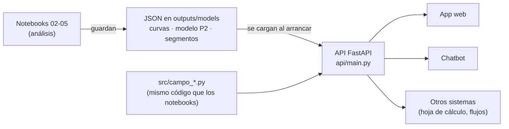

# API de campo (Serie IV)

## Qué es

Un servicio web que responde las cuatro preguntas de la Serie I con una consulta. Otro sistema (una hoja de cálculo,
una aplicación web, un chatbot o un flujo automático) le manda datos en JSON y recibe la respuesta en JSON.

- **Qué pregunta responde cada consulta:** qué variedades ampliar y cada cuántos cortes renovar (pregunta 1), cuánto
  azúcar esperar (pregunta 2), a qué grupo pertenece una variedad (pregunta 3) y qué lotes se renuevan antes o después
  de tiempo (pregunta 4).
- **Cómo funciona:** la API no re-entrena modelos ni lee los datasets. Al arrancar carga los archivos JSON que dejan
  los notebooks (`outputs/models/`) y usa los mismos módulos de `src/` que los notebooks. Por eso sus respuestas
  coinciden con las cifras de los notebooks, y las pruebas automáticas lo comprueban.
- **Documentación interactiva:** al correr la API, `http://localhost:8000/docs` muestra cada consulta con sus campos,
  rangos válidos y ejemplos, y permite probarla desde el navegador (OpenAPI/Swagger).



## Para qué sirve

| Uso | Ejemplo |
|---|---|
| Planificar la siembra | Antes de la siembra, consultar el ranking y simular el margen con el precio del azúcar del momento. |
| Presupuestar la zafra | Estimar el azúcar por acre de cada variedad en cada finca, con una banda de error honesta. |
| Clasificar una variedad nueva | Con sus 4 indicadores contra los testigos, ver a qué grupo se parece. |
| Auditar renovaciones | Subir el CSV de cosechas y ver qué lotes se renovaron antes o después de tiempo, y qué hacer con los lotes en pie. |
| Alimentar otras herramientas | La app de predicción y el chatbot del sitio web consultan esta misma API; no repiten cálculos. |

**Límite principal:** los modelos se entrenaron con ensayos de Louisiana (2010-2021). Sirven para el método y para
ordenar variedades; los valores absolutos de otra región saldrán de sus propios datos (pregunta 4).

## Cómo correrla

| Qué | Comando |
|---|---|
| API con Docker (un solo comando) | `docker compose up --build` → `http://localhost:8000/docs` |
| Todas las pruebas con Docker (incluye PostgreSQL 16) | `docker compose --profile pruebas run --rm pruebas` |
| API sin Docker | `pip install -r requirements.txt` y `uvicorn api.main:app --reload` |
| Pruebas sin Docker | `pytest` (la prueba de PostgreSQL se omite sin `CAMPO_PG_DSN`) |

No necesita los datasets ni variables secretas. `CORS_ORIGINS` (opcional) limita qué sitios web pueden consultarla.

## Consultas

Todas las cifras de los ejemplos salen de llamar a la API con los artefactos del repo.

| Método y ruta | Pregunta | Entrada | Devuelve |
|---|---|---|---|
| `GET /salud` | — | — | estado y cuántas variedades y grupos cargó |
| `GET /campo/variedades?precio=0.20` | 1 | precio (opcional) | las 23 variedades ordenadas por margen, con ciclo óptimo y certeza, y el catálogo de variedades y fincas |
| `POST /campo/ciclo` | 1 | variedad y supuestos económicos (opcionales) | ciclo óptimo, margen por acre y por hectárea, ganancia contra el testigo, precio de equilibrio, margen de cada ciclo posible y curva por corte |
| `POST /campo/pronostico` | 2 | variedad, finca (o `nueva`), corte y, opcional, la ventaja del lote el año pasado | azúcar esperado en lb/acre y t/ha, banda de error y desglose |
| `POST /campo/segmento` | 3 | 4 indicadores en % contra los testigos | grupo, segundo grupo más cercano y distancias |
| `POST /campo/auditoria` | 4 | registros de cosecha en JSON | estado de cada ciclo, diagnóstico por lote y decisión para los lotes en pie |
| `POST /campo/auditoria/csv` | 4 | archivo CSV de cosechas | lo mismo, desde una hoja de cálculo |

### Pregunta 1 · `GET /campo/variedades`

Con los supuestos de la prueba (US$0.20/lb, US$14/t, US$350/acre/año, US$1,100/acre):

```json
{
  "testigo_promedio": {"ciclo_optimo_cortes": 4, "margen_anual_usd_acre": 526.28},
  "variedades": [
    {"puesto": 1, "variedad": "HOCP14-885", "ciclo_optimo_cortes": 4, "margen_anual_usd_acre": 798.1,
     "ganancia_vs_testigos_usd_acre": 271.82, "P_top3": 0.996, "ganancia_ic90_usd_acre": [226.1, 318.8]},
    {"puesto": 2, "variedad": "HOL15-508", "ciclo_optimo_cortes": 4, "margen_anual_usd_acre": 776.56,
     "ganancia_vs_testigos_usd_acre": 250.28, "P_top3": 0.934, "ganancia_ic90_usd_acre": [183.1, 324.7]}
  ]
}
```

`P_top3` es la probabilidad de quedar entre las 3 mejores al remuestrear ensayos; el IC90 es el intervalo de la
ganancia. Ambos se calcularon con los supuestos base.

### Pregunta 1 · `POST /campo/ciclo`

Simula otro escenario. Ejemplo: HOCP14-885 si el azúcar baja a US$0.15/lb.

```json
{"variedad": "HOCP14-885", "precio": 0.15}
```

```json
{
  "ciclo_optimo_cortes": 4, "margen_anual_usd_acre": 331.4, "margen_anual_usd_ha": 818.91,
  "ganancia_vs_testigos_usd_acre": 190.4,
  "testigo_promedio": {"ciclo_optimo_cortes": 5, "margen_anual_usd_acre": 141.01},
  "precio_equilibrio_usd_lb": 0.1132,
  "margen_por_ciclo": [{"cortes": 1, "margen_anual_usd_acre": -372.89}, {"cortes": 2, "margen_anual_usd_acre": 161.7},
                       {"cortes": 3, "margen_anual_usd_acre": 290.3}, {"cortes": 4, "margen_anual_usd_acre": 331.4},
                       {"cortes": 5, "margen_anual_usd_acre": 323.79}]
}
```

Cómo leerlo: a US$0.15/lb la variedad sigue rindiendo más con 4 cortes y deja de cubrir costos por debajo de
US$0.113/lb. El testigo promedio pasa a convenir con 5 cortes. Campos opcionales: `corte`, `mantenimiento`,
`renovacion`, `barbecho` (años sin caña) y `extrapolar` (extender la ventaja más allá del último corte medido).

### Pregunta 2 · `POST /campo/pronostico`

```json
{"variedad": "L01-299", "finca": "MAGNOLIA", "corte": 2, "ventaja_lote_anterior": 1.05}
```

```json
{
  "escenario": 1, "azucar_lb_acre": 6092.1, "banda_lb_acre": [4299.6, 8047.0],
  "azucar_t_ha": 6.828, "banda_t_ha": [4.819, 9.02], "cobertura_real_banda": 0.736,
  "desglose_log": {"base_del_corte": 8.8363, "efecto_finca": -0.2443, "ventaja_variedad": 0.1138,
                   "ventaja_lote_anterior": 0.0091}
}
```

- `ventaja_lote_anterior`: azúcar de la variedad ÷ testigos en el mismo lote el año pasado (1.05 = 5 % arriba). Si no
  se conoce, se omite.
- `finca: "nueva"` usa el modelo para fincas sin historia (escenario 2); la banda es más ancha.
- La banda cubrió el 74 % de los casos en la validación por zafra (no el 80 % nominal): se reporta la cobertura real.
- Una variedad sin historia en etapa 5 devuelve error 422: es el escenario 3, documentado como pendiente en el README.

### Pregunta 3 · `POST /campo/segmento`

```json
{"cana_vs_testigos_pct": 9.9, "trs_vs_testigos_pct": 7.5, "cana_por_corte_vs_testigos_pct": 1.7, "sigma_interaccion_pct": 8.5}
```

```json
{
  "grupo": "Completas: caña, calidad y longevidad", "segundo_grupo": "Sin ventaja clara",
  "distancias": {"Completas: caña, calidad y longevidad": 1.81, "Sin ventaja clara": 2.389, "Calidad sin caña": 2.665,
                 "Mucha caña, menos calidad": 2.827, "Inestables y de vida corta": 4.046},
  "estabilidad_del_grupo_jaccard": 0.698
}
```

Los indicadores son los de la tabla del notebook 04: caña por acre en plantía, TRS, cambio de la caña por corte (todos
en % contra los testigos núcleo) y desvío de la ventaja entre fincas y años (menor = más estable). Como no hay grupos
naturales, la respuesta incluye el segundo grupo y las distancias: si están cerca, conviene decidir con la pregunta 1.

### Pregunta 4 · `POST /campo/auditoria` y `/campo/auditoria/csv`

Entrada: una fila por lote y corte. Columnas: `zafra`, `finca`, `lote`, `variedad`, `corte` (0 = plantía;
recomendado), `tch` (t de caña por hectárea) y `rendimiento` (kg de azúcar por t; opcional). El CSV usa los mismos
nombres de columna.

Ejemplo: un lote que renovó CG02-163 después de 2 cortes y lleva 4 cortes de CP72-2086.

```json
{
  "optimo_cortes": 4,
  "ciclos": [
    {"variedad": "CG02-163", "zafra_inicio": 2016, "zafra_fin": 2017, "cortes_ciclo": 2, "cerrado": true,
     "estado": "renovación temprana"},
    {"variedad": "CP72-2086", "zafra_inicio": 2018, "zafra_fin": 2021, "cortes_ciclo": 4, "cerrado": false,
     "estado": "renovar al cerrar la zafra"}
  ],
  "lotes": [{"lote": "F01-L1", "diagnostico": "renueva antes de tiempo"}],
  "decisiones": [{"lote": "F01-L1", "corte_siguiente": 4, "tch_esperado": 87.21, "margen_siguiente": 2415.33,
                  "margen_ciclo_nuevo": 3553.32, "decision": "renovar"}]
}
```

`decision` compara el margen esperado del próximo corte del lote con el margen promedio de un ciclo nuevo en ese
mismo lote (US$/ha). Sin la columna `corte` la API igual responde, pero no detecta las renovaciones que repiten
variedad.

## Validación de entradas y errores

Cada campo tiene un rango físico o económico plausible (por ejemplo, precio entre US$0.05 y 1.00/lb, corte de 0 a 4,
TCH entre 0 y 400). Una entrada fuera de rango, una variedad o finca desconocida, o un CSV sin las columnas necesarias
devuelven **422** con un mensaje en español que dice qué corregir.

## Cómo se verificó

`tests/test_api.py` llama a la API y comprueba las cifras de control de la Serie I:

| Pregunta | Qué se comprueba |
|---|---|
| 1 | margen de referencia US$526.3/acre/año; ciclo, margen, ganancia y precio de equilibrio de las 23 variedades iguales al notebook 02; el top 3 no cambia entre US$0.10 y 0.30/lb |
| 2 | las 509 predicciones de 2022 del notebook 03 (467 lotes + 42 plantías) con diferencia ≤ 1 lb/acre |
| 3 | el 100 % de las 23 asignaciones del notebook 04 |
| 4 | la auditoría de la API es igual a la de pandas y clasifica bien 1,143 de 1,143 ciclos; el CSV da lo mismo que el JSON |
| todas | entradas inválidas devuelven 422 |

`tests/test_esquema_postgres.py` comprueba además que la auditoría hecha en PostgreSQL es igual a la de pandas.
La última corrida dentro de Docker (API + PostgreSQL 16) quedó en `outputs/tests/pytest_docker.txt`: 52 pruebas aprobadas.
