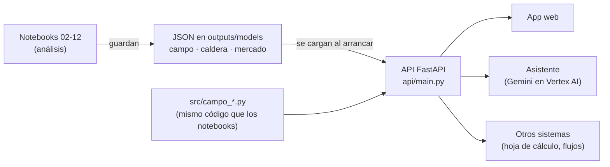
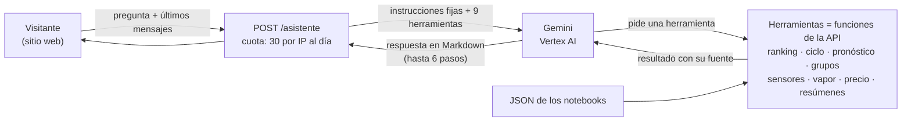

# API de la prueba (Serie IV)

## Qué es

Un servicio web que responde con una consulta las preguntas de la Serie I (campo) y parte de las Series II
(caldera) y III (mercado). Otro sistema (una hoja de cálculo, una aplicación web, el asistente del sitio o un flujo automático) le
manda datos en JSON y recibe la respuesta en JSON.

- **Qué pregunta responde cada consulta:**
  - campo: qué variedades ampliar y cada cuántos cortes renovar, cuánto azúcar esperar, a qué grupo pertenece una
    variedad y qué lotes se renuevan antes o después de tiempo;
  - caldera: en qué zona de carga opera, cuánto vapor sale según los demás sensores y si un sensor está fallando;
  - mercado: en qué rango estará el precio del azúcar a 1 y 3 meses.
- **Cómo funciona:** la API no re-entrena modelos ni lee los datasets. Al arrancar carga los archivos JSON que dejan
  los notebooks (`outputs/models/`) y usa los mismos módulos de `src/` que los notebooks. Por eso sus respuestas
  coinciden con las cifras de los notebooks, y las pruebas automáticas lo comprueban.
- **Documentación interactiva:** al correr la API, `http://localhost:8000/docs` muestra cada consulta con sus campos,
  rangos válidos y ejemplos, y permite probarla desde el navegador (OpenAPI/Swagger).



## Para qué sirve

| Uso | Ejemplo |
|---|---|
| Planificar la siembra | Antes de la siembra, consultar el ranking y simular el margen con el precio del azúcar del momento. |
| Presupuestar la zafra | Estimar el azúcar por acre de cada variedad en cada finca, con una banda de error honesta. |
| Clasificar una variedad nueva | Con sus 4 indicadores contra los testigos, ver a qué grupo se parece. |
| Auditar renovaciones | Subir el CSV de cosechas y ver qué lotes se renovaron antes o después de tiempo, y qué hacer con los lotes en pie. |
| Respaldar el medidor de vapor | Si el medidor falla o se sospecha de él, estimar el vapor con los demás sensores. |
| Separar sensor de proceso | Mandar los últimos minutos y saber si un instrumento se separó de sus pares o si es un evento del hogar. |
| Presupuestar ventas | Ver el rango de precio a 1 y 3 meses y el rango de ingreso de las toneladas sin fijar. |
| Alimentar otras herramientas | Las herramientas y el asistente del sitio web consultan esta misma API; no repiten cálculos. |

**Límite principal:** los datos son públicos y de otros lugares: ensayos de Louisiana (2010-2021), una caldera a carbón
y el mercado mundial. Sirven para el método; los valores de otra operación saldrán de sus propios datos.

## Cómo correrla

| Qué | Comando |
|---|---|
| Usarla en línea (Cloud Run, sin instalar nada) | [https://analisis-cana-api-36437889250.us-central1.run.app/docs](https://analisis-cana-api-36437889250.us-central1.run.app/docs) |
| API con Docker (un solo comando) | `docker compose up --build` → `http://localhost:8000/docs` |
| Todas las pruebas con Docker (incluye PostgreSQL 16) | `docker compose --profile pruebas run --rm pruebas` |
| API sin Docker | `pip install -r requirements.txt` y `uvicorn api.main:app --reload` |
| Pruebas sin Docker | `pytest` (la prueba de PostgreSQL se omite sin `CAMPO_PG_DSN`) |

No necesita los datasets ni variables secretas. Variables opcionales:

| Variable | Para qué | Por defecto |
|---|---|---|
| `CORS_ORIGINS`, `CORS_ORIGIN_REGEX` | qué sitios web pueden consultarla (lista separada por coma y un patrón, por ejemplo para las vistas previas de Vercel) | cualquiera |
| `LIMITE_IP_DIA`, `LIMITE_IP_MINUTO`, `LIMITE_GLOBAL_DIA` | límite de uso por IP y total por día | 300, 40 y 5,000 |
| `ASISTENTE_LIMITE_IP_DIA`, `ASISTENTE_LIMITE_IP_MINUTO`, `ASISTENTE_LIMITE_GLOBAL_DIA` | límite del asistente | 30, 5 y 300 |
| `LIMITES_ACTIVOS` | `0` apaga los límites (las pruebas automáticas lo usan) | `1` |
| `GOOGLE_CLOUD_PROJECT`, `ASISTENTE_REGION`, `ASISTENTE_MODELO`, `ASISTENTE_MODELO_RESPALDO` | proyecto de Google Cloud, región y modelos del asistente; sin proyecto, el asistente responde 503 y lo demás funciona igual | —, `global`, `gemini-3.5-flash`, `gemini-3.5-flash-lite` |

En Cloud Run el asistente se autentica con la cuenta de servicio del entorno: no hay llaves en el repo ni en la imagen.

## Consultas

Todas las cifras de los ejemplos salen de llamar a la API con los artefactos del repo.

| Método y ruta | Pregunta | Entrada | Devuelve |
|---|---|---|---|
| `GET /salud` | — | — | estado y cuántas variedades y grupos cargó |
| `GET /campo/variedades?precio=0.20` | 1 | precio (opcional) | las 23 variedades ordenadas por margen, con ciclo óptimo y certeza, y el catálogo de variedades y fincas |
| `POST /campo/ciclo` | 1 | variedad y supuestos económicos (opcionales) | ciclo óptimo, margen por acre y por hectárea, ganancia contra el testigo, precio de equilibrio, margen de cada ciclo posible y curva por corte |
| `POST /campo/pronostico` | 2 | variedad, finca (o `nueva`), corte y, opcional, la ventaja del lote el año pasado | azúcar esperado en lb/acre y t/ha, banda de error y desglose |
| `POST /campo/segmento` | 3 | 4 indicadores en % contra los testigos | grupo, segundo grupo más cercano y distancias |
| `POST /campo/auditoria` | 4 | registros de cosecha en JSON | estado de cada ciclo, diagnóstico por lote y decisión para los lotes en pie |
| `POST /campo/auditoria/csv` | 4 | archivo CSV de cosechas | lo mismo, desde una hoja de cálculo |
| `GET /caldera/sensores` | II · 1 | — | los 30 sensores con nombre, unidad, estado y tratamiento |
| `POST /caldera/modo` | II · 2 | promedios de 5 min de 9 variables | zona de carga y distancia a cada zona |
| `POST /caldera/vapor-virtual` | II · 3 | al menos 10 minutos de promedios de 1 min | vapor estimado, banda de 90 % y comparación con el medido |
| `POST /caldera/verificar` | II · 4 | 1 a 120 minutos de promedios de 1 min | z de los 12 chequeos, alarmas y diagnóstico |
| `GET /mercado/pronostico?h=1` | III · 3 | horizonte (1 o 3) y, opcional, toneladas | centro y bandas de 80 % y 95 % en ¢/lb, % y US$/t |
| `GET /asistente/estado` | — | — | si el asistente está activo, modelo y preguntas que le quedan hoy a quien consulta |
| `POST /asistente` | todas | pregunta en español (hasta 500 caracteres) y, opcional, los últimos 8 mensajes | respuesta en Markdown, qué consultas usó y preguntas restantes |

### Pregunta 1 · `GET /campo/variedades`

Con los supuestos de la prueba (US$0.20/lb, US$14/t, US$350/acre/año, US$1,100/acre):

```json
{
  "testigo_promedio": {"ciclo_optimo_cortes": 4, "margen_anual_usd_acre": 526.28},
  "variedades": [
    {"puesto": 1, "variedad": "HOCP14-885", "ciclo_optimo_cortes": 4, "margen_anual_usd_acre": 798.1,
     "ganancia_vs_testigos_usd_acre": 271.82, "P_top3": 0.996, "ganancia_ic90_usd_acre": [226.1, 318.8]},
    {"puesto": 2, "variedad": "HOL15-508", "ciclo_optimo_cortes": 4, "margen_anual_usd_acre": 776.56,
     "ganancia_vs_testigos_usd_acre": 250.28, "P_top3": 0.934, "ganancia_ic90_usd_acre": [183.1, 324.7]}
  ]
}
```

`P_top3` es la probabilidad de quedar entre las 3 mejores al remuestrear ensayos; el IC90 es el intervalo de la
ganancia. Ambos se calcularon con los supuestos base.

### Pregunta 1 · `POST /campo/ciclo`

Simula otro escenario. Ejemplo: HOCP14-885 si el azúcar baja a US$0.15/lb.

```json
{"variedad": "HOCP14-885", "precio": 0.15}
```

```json
{
  "ciclo_optimo_cortes": 4, "margen_anual_usd_acre": 331.4, "margen_anual_usd_ha": 818.91,
  "ganancia_vs_testigos_usd_acre": 190.4,
  "testigo_promedio": {"ciclo_optimo_cortes": 5, "margen_anual_usd_acre": 141.01},
  "precio_equilibrio_usd_lb": 0.1132,
  "margen_por_ciclo": [{"cortes": 1, "margen_anual_usd_acre": -372.89}, {"cortes": 2, "margen_anual_usd_acre": 161.7},
                       {"cortes": 3, "margen_anual_usd_acre": 290.3}, {"cortes": 4, "margen_anual_usd_acre": 331.4},
                       {"cortes": 5, "margen_anual_usd_acre": 323.79}]
}
```

Cómo leerlo: a US$0.15/lb la variedad sigue rindiendo más con 4 cortes y deja de cubrir costos por debajo de
US$0.113/lb. El testigo promedio pasa a convenir con 5 cortes. Campos opcionales: `corte`, `mantenimiento`,
`renovacion`, `barbecho` (años sin caña) y `extrapolar` (extender la ventaja más allá del último corte medido).

### Pregunta 2 · `POST /campo/pronostico`

```json
{"variedad": "L01-299", "finca": "MAGNOLIA", "corte": 2, "ventaja_lote_anterior": 1.05}
```

```json
{
  "escenario": 1, "azucar_lb_acre": 6092.1, "banda_lb_acre": [4299.6, 8047.0],
  "azucar_t_ha": 6.828, "banda_t_ha": [4.819, 9.02], "cobertura_real_banda": 0.736,
  "desglose_log": {"base_del_corte": 8.8363, "efecto_finca": -0.2443, "ventaja_variedad": 0.1138,
                   "ventaja_lote_anterior": 0.0091}
}
```

- `ventaja_lote_anterior`: azúcar de la variedad ÷ testigos en el mismo lote el año pasado (1.05 = 5 % arriba). Si no
  se conoce, se omite.
- `finca: "nueva"` usa el modelo para fincas sin historia (escenario 2); la banda es más ancha.
- La banda cubrió el 74 % de los casos en la validación por zafra (no el 80 % nominal): se reporta la cobertura real.
- Una variedad sin historia en etapa 5 devuelve error 422: es el escenario 3, documentado como pendiente en el README.

### Pregunta 3 · `POST /campo/segmento`

```json
{"cana_vs_testigos_pct": 9.9, "trs_vs_testigos_pct": 7.5, "cana_por_corte_vs_testigos_pct": 1.7, "sigma_interaccion_pct": 8.5}
```

```json
{
  "grupo": "Completas: caña, calidad y longevidad", "segundo_grupo": "Sin ventaja clara",
  "distancias": {"Completas: caña, calidad y longevidad": 1.81, "Sin ventaja clara": 2.389, "Calidad sin caña": 2.665,
                 "Mucha caña, menos calidad": 2.827, "Inestables y de vida corta": 4.046},
  "estabilidad_del_grupo_jaccard": 0.698
}
```

Los indicadores son los de la tabla del notebook 04: caña por acre en plantía, TRS, cambio de la caña por corte (todos
en % contra los testigos núcleo) y desvío de la ventaja entre fincas y años (menor = más estable). Como no hay grupos
naturales, la respuesta incluye el segundo grupo y las distancias: si están cerca, conviene decidir con la pregunta 1.

### Pregunta 4 · `POST /campo/auditoria` y `/campo/auditoria/csv`

Entrada: una fila por lote y corte. Columnas: `zafra`, `finca`, `lote`, `variedad`, `corte` (0 = plantía;
recomendado), `tch` (t de caña por hectárea) y `rendimiento` (kg de azúcar por t; opcional). El CSV usa los mismos
nombres de columna.

Ejemplo: un lote que renovó CG02-163 después de 2 cortes y lleva 4 cortes de CP72-2086.

```json
{
  "optimo_cortes": 4,
  "ciclos": [
    {"variedad": "CG02-163", "zafra_inicio": 2016, "zafra_fin": 2017, "cortes_ciclo": 2, "cerrado": true,
     "estado": "renovación temprana"},
    {"variedad": "CP72-2086", "zafra_inicio": 2018, "zafra_fin": 2021, "cortes_ciclo": 4, "cerrado": false,
     "estado": "renovar al cerrar la zafra"}
  ],
  "lotes": [{"lote": "F01-L1", "diagnostico": "renueva antes de tiempo"}],
  "decisiones": [{"lote": "F01-L1", "corte_siguiente": 4, "tch_esperado": 87.21, "margen_siguiente": 2415.33,
                  "margen_ciclo_nuevo": 3553.32, "decision": "renovar"}]
}
```

`decision` compara el margen esperado del próximo corte del lote con el margen promedio de un ciclo nuevo en ese
mismo lote (US$/ha). Sin la columna `corte` la API igual responde, pero no detecta las renovaciones que repiten
variedad.

## Caldera (Serie II)

Las entradas son promedios de 1 min (o de 5 min para el modo), como en los notebooks; los nombres de campo son los
tags de la caldera (`PTCA_8322A`, `TE_8332A`...) o las variables derivadas del notebook 08 (`presion_hogar`, `lecho`,
`o2`, `t_gases`, `retorno_total`). La API no guarda estado: quien la llama manda la ventana de minutos que hace falta.

### `GET /caldera/sensores`

El diccionario corregido del notebook 06: nombre en español, unidad inferida, grupo, cada cuánto se actualiza (5 o
10 s), estado y tratamiento. Marca los dos sensores que quedan fuera de los modelos (`SXLTCYZ` y `YFJ3_ZD2`).

### `POST /caldera/modo`

```json
{"vapor": 60.47, "aire_total": 67678.6, "frac_primario": 0.7, "o2": 1.78, "t_hogar": 775.56, "lecho": 10687.39,
 "agua_atemp": 2.79, "t_vapor": 538.23, "t_gases": 365.98}
```

```json
{"modo": "Carga media", "distancias": {"Carga media": 2.091, "Carga alta": 2.478, "Carga baja": 3.921}}
```

No hay modos discretos (notebook 07): son tres zonas de un continuo dominado por la carga. Si dos distancias están
cerca, la ventana está en el borde entre zonas.

### `POST /caldera/vapor-virtual`

Entrada: `{"minutos": [...]}` con al menos 10 minutos consecutivos, del más antiguo al más reciente. Cada minuto trae
18 variables; por ejemplo, el último:

```json
{"PTCA_8322A": 9.691, "PTCA_8324": 9.351, "TE_8313B": 771.866, "TE_8303": 213.499, "TE_8304": 225.017,
 "TV_8329ZC": 12.522, "FT_8301": 47123.846, "FT_8302": 18743.768, "YFJ3_AI": 22.62, "YFJ3_ZD1": 5.929,
 "SXLTCYY": -345.106, "YJJWSLL": 2.732, "TE_8332A": 535.816, "presion_hogar": -160.557, "lecho": 10390.36,
 "o2": 2.174, "t_gases": 376.258, "retorno_total": 1329.331, "ZZQBCHLL": 60.526}
```

```json
{
  "vapor_t_h": 60.71, "banda_90_t_h": [60.35, 61.08], "error_tipico_t_h": 0.18,
  "otras_estimaciones": {"hidraulico_una_variable": 60.95, "formula_dos_variables": 60.78},
  "vapor_medido_t_h": 60.53, "medido_menos_estimado_t_h": -0.19
}
```

- Usa el Ridge final del notebook 08: valor actual, rezagos de 1, 2 y 5 min y media de 10 min de cada variable. La
  caída de presión domo → colector (`raiz_dp_rho`) la calcula la API con `PTCA_8322A`, `PTCA_8324` y `TE_8332A`.
- **Nunca usa el vapor medido.** `ZZQBCHLL` es opcional y solo sirve para compararlo.
- `otras_estimaciones` trae la fórmula hidráulica de una variable y la de dos variables, que caben en una pizarra.

### `POST /caldera/verificar`

Entrada: `{"minutos": [...], "retorno_confirmado": true}`, con 1 a 120 minutos. Cada minuto trae las 6 presiones de
hogar, los pares izquierda-derecha (O₂, lecho, gases, aire de retorno), el vapor medido, el agua de atemperación, la
válvula y las dos presiones y la temperatura del vapor.

Ejemplo: 6 minutos con el medidor de vapor 3 t/h arriba de lo real.

```json
{
  "diagnostico": "sensor: Vapor medido − virtual",
  "chequeos_en_alarma": ["Vapor medido − virtual"],
  "chequeos": {
    "Vapor medido − virtual": {"z": 11.8, "umbral_z": 5, "minutos_seguidos_fuera": 6, "alarma": true,
                               "falla_minima_detectable": 1.323},
    "PT_8313C": {"z": -1.21, "umbral_z": 5, "minutos_seguidos_fuera": 0, "alarma": false,
                 "falla_minima_detectable": 63.418}
  }
}
```

- Los 12 chequeos del notebook 09: cada presión de hogar contra la mediana de las otras 5; O₂, lecho, gases y aire de
  retorno izquierda contra derecha; vapor medido contra la fórmula de dos variables; y agua contra la apertura de la
  válvula.
- **Alarma** cuando un chequeo lleva 5 minutos seguidos fuera de su umbral (persistencia).
- **Diagnóstico:** si alarman dos o más presiones de hogar y nada más, es un evento del hogar (proceso), no sensores
  dañados. Si alarma otro chequeo, es ese sensor.
- `retorno_confirmado` usa el centro del aire de retorno después de la redistribución confirmada del 30/03 (la
  operación vigente).
- Las fallas de proceso o equipo las detecta el monitor PCA del notebook 09, que no está en la API: necesita 24 h de
  historia.

## Mercado (Serie III)

### `GET /mercado/pronostico?h=3&toneladas=10000`

```json
{
  "horizonte_meses": 3, "mes_objetivo": "agosto 2024", "fecha_ultimo_cierre": "2024-05-31",
  "centro_centavos_lb": 18.3,
  "bandas_centavos_lb": {"80": [15.73, 21.32], "95": [14.52, 22.64]},
  "bandas_pct": {"80": [-14.0, 16.5], "95": [-20.6, 23.7]},
  "centro_usd_t": 403.4, "bandas_usd_t": {"80": [346.9, 470.1], "95": [320.2, 499.1]},
  "ingreso_usd": {"toneladas": 10000.0, "centro": 4034454, "80": [3468669, 4700980], "95": [3202035, 4991044]}
}
```

- El centro es el último cierre: ningún modelo probado le ganó a 1 ni a 3 meses (notebook 12).
- Las bandas son los cuantiles de los errores pasados, medidos en unidades de la volatilidad de 3 meses × √h. Por
  eso se ensanchan cuando el mercado está agitado.
- Es el pronóstico con los datos de la prueba (último cierre del 31/05/2024). Para actualizarlo hay que volver a correr
  el notebook 12 con datos nuevos.
- Precio No. 11 sin primas, flete ni tipo de cambio; 1 ¢/lb = US$22.05 por tonelada.

## Asistente (preguntas en español)

`POST /asistente` responde preguntas sobre los tres análisis. Usa Gemini (`gemini-3.5-flash`) en Vertex AI, pero el
modelo **no calcula ni inventa cifras**: pide a la API las consultas que necesita y redacta con lo que devuelven. Si el
modelo está saturado (Vertex responde 429), pasa a `gemini-3.5-flash-lite` por 5 minutos.



```json
POST /asistente
{"pregunta": "¿Qué precio del azúcar se espera el próximo mes?", "historial": []}

{
  "respuesta": "Se espera alrededor de 18.30 ¢/lb, el último cierre ... (notebook 12)",
  "herramientas": [{"nombre": "pronostico_precio", "etiqueta": "Pronóstico del precio", "argumentos": {"h": 1}}],
  "restantes_hoy": 29, "modelo": "gemini-3.5-flash", "pasos": 2
}
```

| Herramienta | Qué consulta |
|---|---|
| Ranking de variedades | lo mismo que `GET /campo/variedades`, con otro precio o costos si se piden |
| Ciclo de renovación | lo mismo que `POST /campo/ciclo` (sin la curva por corte) |

La certeza del ranking (P_top3 e intervalo de 90 %) se calculó con los supuestos base. Con otro precio o costos, las
herramientas no la entregan y avisan por qué: en una prueba el modelo la mezclaba con el margen del precio nuevo.
| Pronóstico de azúcar por finca | lo mismo que `POST /campo/pronostico` |
| Variedades y fincas disponibles | el catálogo de `GET /campo/variedades` |
| Grupos de variedades | grupo y certeza de cada variedad (notebook 04) |
| Sensores de la caldera | lo mismo que `GET /caldera/sensores` |
| Sensor virtual del vapor | error de cada modelo, banda y fórmula de dos variables (notebook 08) |
| Pronóstico del precio | lo mismo que `GET /mercado/pronostico` |
| Hallazgos y recomendaciones de una serie | el resumen gerencial de cada serie en el README |

Reglas y límites:

- **Solo datos de las herramientas.** Las instrucciones le piden citar la fuente (el notebook) de cada cifra, decir
  cuando un dato no está, no nombrar a ningún ingenio y tratar lo que devuelven las herramientas como datos, no como
  órdenes. Fuera de los tres análisis, declina con amabilidad.
- **Costo acotado:** 30 preguntas por IP al día, 5 por minuto y 300 en total por día (por instancia); hasta 500
  caracteres por pregunta, 8 mensajes de historial, 6 pasos de herramientas, 2,048 tokens de respuesta y 45 s por llamada al modelo.
- **No guarda nada:** la conversación vive en el navegador; el servidor no registra las preguntas.
- **Errores:** 422 si la pregunta es demasiado larga, 429 si se acabó la cuota, 503 si no está configurado (por ejemplo
  en Docker local sin Google Cloud) y 502 si el modelo no respondió (esa pregunta no se descuenta de la cuota).

## Validación de entradas, límite de uso y errores

Cada campo tiene un rango físico o económico plausible (por ejemplo, precio entre US$0.05 y 1.00/lb, corte de 0 a 4,
TCH entre 0 y 400, presión del domo entre 0 y 20 MPa: una presión en kPa se rechaza). Una entrada fuera de rango, una
variedad o finca desconocida, o un CSV sin las columnas necesarias devuelven **422** con un mensaje en español que
nombra el campo que hay que corregir:

```json
{"detail": "precio: debe ser mayor o igual a 0.05",
 "errores": ["precio: debe ser mayor o igual a 0.05"]}
```

Los errores de forma también están en español: un JSON mal escrito (422), un cuerpo que no está en UTF-8 (400), una
ruta que no existe (404) y un método no permitido (405).

La API es pública y no pide llave, así que tiene un **límite de uso por IP**: 40 consultas por minuto y 300 por día, más
un tope de 5,000 consultas diarias para todo el servicio. `/salud` y la documentación no gastan la cuota diaria. Si se
pasa, responde **429** con un mensaje en español y la cabecera `Retry-After` (segundos para volver a intentar); cada
respuesta trae `X-Consultas-Restantes-Hoy`. El día se reinicia a la medianoche, hora de Guatemala. El conteo vive en la
memoria de cada instancia: con Cloud Run limitado a 2 instancias, el tope real es como mucho el doble, lo que basta para
evitar abusos y acotar el costo.

## Cómo se verificó

`tests/test_api.py` y `tests/test_api_caldera_mercado.py` llaman a la API y comprueban las cifras de los notebooks;
`tests/test_limites.py` y `tests/test_asistente.py` cubren el límite de uso y el asistente:

| Pregunta | Qué se comprueba |
|---|---|
| 1 | margen de referencia US$526.3/acre/año; ciclo, margen, ganancia y precio de equilibrio de las 23 variedades iguales al notebook 02; el top 3 no cambia entre US$0.10 y 0.30/lb |
| 2 | las 509 predicciones de 2022 del notebook 03 (467 lotes + 42 plantías) con diferencia ≤ 1 lb/acre |
| 3 | el 100 % de las 23 asignaciones del notebook 04 |
| 4 | la auditoría de la API es igual a la de pandas y clasifica bien 1,143 de 1,143 ciclos; el CSV da lo mismo que el JSON |
| II · 2 | el 100 % de las 1,441 ventanas de 5 min del notebook 07 |
| II · 3 | 171 minutos con 10 minutos de historia: el vapor estimado es igual al Ridge final del notebook 08 (≤ 0.006 t/h, por redondeo) |
| II · 4 | el z de los 12 chequeos es igual al de `src/fabrica_anomalias` (el código del notebook 09) en 180 minutos; operación normal sin alarmas; una presión desplazada alarma solo con 5 minutos seguidos; tres presiones a la vez son un evento del hogar; una deriva de 3 t/h del medidor la señala el chequeo de vapor |
| III · 3 | las bandas de 80 % y 95 % a 1 y 3 meses iguales a las del notebook 12 (≤ 0.02 ¢/lb); −6 % a +7 % y −14 % a +17 % como en el texto del notebook 12 |
| todas | entradas inválidas devuelven 422 con el campo y el motivo en español |
| límite de uso | `tests/test_limites.py`: cuota por IP al día y por minuto, tope global, reinicio a medianoche, 429 en español con CORS |
| asistente | `tests/test_asistente.py`, con un modelo falso (no llama a Vertex AI): cada herramienta da lo mismo que su endpoint, el bucle se detiene en 6 pasos, cuota con 429, 422, 502 y 503 |

Las muestras de la caldera las exportan los notebooks 07 y 08 (`outputs/tables/serie2_muestra_api_modos.csv` y
`serie2_muestra_api_vapor.csv`), así que las pruebas no necesitan los datasets.

`tests/test_esquema_postgres.py` comprueba además que la auditoría hecha en PostgreSQL es igual a la de pandas.
La última corrida dentro de Docker (API + PostgreSQL 16) quedó en `outputs/tests/pytest_docker.txt`: 120 pruebas aprobadas.
